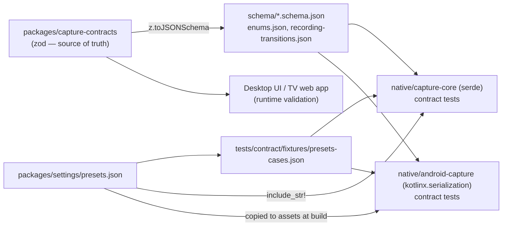
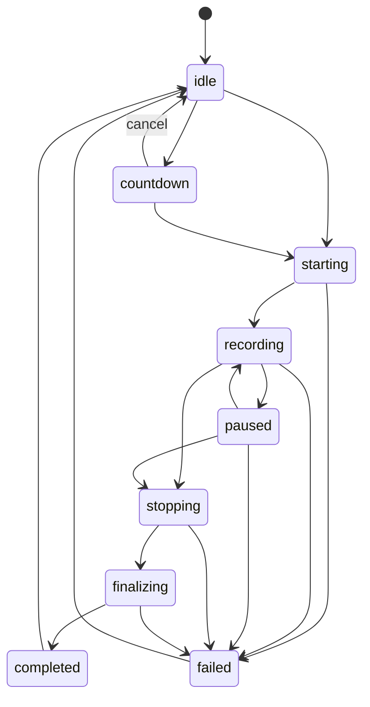
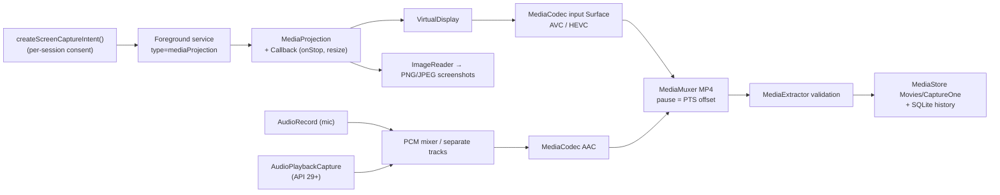
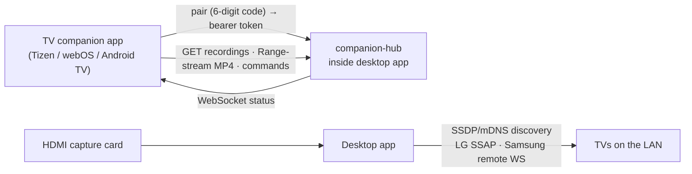

# CaptureOne — Technical Architecture

CaptureOne is a standalone, offline-first screen capture and recording product for
Windows, macOS, Linux, Android phones/tablets, Android TV / Google TV, and (as
companion apps) Samsung Tizen and LG webOS televisions.

The core rule: **capture uses each platform's native API; encoding and media
processing are separate concerns; every platform reports honestly what it can do.**

## 1. Repository layout

```
.
├── apps/
│   ├── desktop/            Tauri 2 + React + TypeScript desktop app (Windows, macOS, Linux)
│   │   ├── src/            React UI (Record, Library, Settings, Devices, indicator, region selector)
│   │   └── src-tauri/      Rust app shell: commands, SQLite library, settings, tray, shortcuts
│   ├── android/            Gradle root + phone/tablet app (Kotlin, Jetpack Compose)
│   ├── android-tv/         Android TV / Google TV app (Compose for TV, D-pad UI)
│   ├── tv-web/             Shared TypeScript 10-foot web app for Tizen and webOS
│   ├── samsung-tv/         Tizen TV packaging (config.xml → .wgt)
│   └── lg-tv/              webOS TV packaging (appinfo.json → .ipk)
├── native/
│   ├── capture-core/       Rust contract mirror: CaptureBackend trait, types, frames, presets, state machine
│   ├── media-engine/       Rust: pacing, A/V timeline, ffmpeg encoders, muxing, validation, recovery
│   ├── linux-capture/      X11 (x11rb, MIT-SHM, XFixes) + PulseAudio monitor backend
│   ├── windows-capture/    Windows Graphics Capture + WASAPI loopback backend
│   ├── macos-capture/      ScreenCaptureKit backend (video + system audio)
│   ├── android-capture/    Kotlin library: MediaProjection + MediaCodec + MediaMuxer engine
│   └── capture-cli/        Headless recorder used for automated verification on every OS
├── packages/
│   ├── capture-contracts/  Source of truth (zod) + exported JSON Schemas
│   ├── settings/           presets.json, resolution/bitrate/file-size math, AppSettings schema
│   ├── design-system/      React components and tokens
│   ├── media-metadata/     Media metadata helpers for UIs
│   └── shared-types/       Misc shared TS types
├── services/
│   ├── companion-hub/      LAN HTTP/WebSocket hub embedded in the desktop app (pairing, browse, stream, remote record)
│   └── device-discovery/   SSDP/mDNS discovery, LG SSAP and Samsung remote-control clients
├── tests/                  contract fixtures, integration suites
├── docs/                   architecture, platform capabilities, installation, release
└── scripts/
```

The repository itself is the monorepo root (pnpm workspaces for TypeScript, a Cargo
workspace for Rust, a Gradle build rooted at `apps/android` for Kotlin).

## 2. The shared capture contract



The contract defines:

| Concern | Types |
|---|---|
| Capability discovery | `CapabilityReport`, `FeatureKey`, `SupportLevel` (`native` / `partial` / `companion-only` / `external-hardware` / `unsupported`), `EncoderInfo` |
| Permissions | `PermissionKind`, `PermissionState` (incl. `per-session` for Android MediaProjection, `not-applicable` for Windows) |
| Sources | `CaptureSource`, `CaptureTarget` (display / window / region / device) |
| Recording configuration | `RecordingConfig` (video, audio, output, limits, countdown) |
| Lifecycle | `RecordingState` + canonical `RECORDING_TRANSITIONS`, `RecordingStatus`, `StopReason` |
| Screenshots | `ScreenshotRequest` |
| Output metadata | `MediaMetadata` with `MediaValidation` (post-write inspection) |
| Errors | `CaptureError` with 15 `CaptureErrorCode`s and user-facing messages |
| Desktop IPC | Tauri command names/args/results, event names, window labels |
| Companion protocol | `HubInfo`, `PairRequest/Response`, `RemoteCommand`, `HubEvent`, `DiscoveredDevice`, REST routes |

Every implementation (Rust, Kotlin, the TV web app) is tested against the same JSON
Schemas, the same enum spellings, the same state-transition table and the same
preset fixtures, so a drift in any language fails CI (`.github/workflows/ci.yml`
also fails if regenerated schemas differ from the committed ones).

### Recording state machine



## 3. Desktop pipeline (Windows / macOS / Linux)

```mermaid
flowchart LR
  subgraph Backend["CaptureBackend (per OS)"]
    WGC["Windows Graphics Capture<br/>+ WASAPI loopback"]
    SCK["ScreenCaptureKit<br/>video + audio"]
    X11["X11 MIT-SHM + XFixes<br/>+ PulseAudio monitor"]
  end
  MIC["Microphone (cpal:<br/>WASAPI / CoreAudio / ALSA)"]
  Backend -->|BGRA VideoFrame| PACER["Pacer (CFR on active clock)<br/>dup/drop, crop, pause"]
  Backend -->|f32 PCM| AT1["Audio timeline (system)"]
  MIC -->|f32 PCM| AT2["Audio timeline (mic)"]
  PACER -->|rawvideo stdin| VENC["ffmpeg video encoder<br/>h264/hevc: MF · VideoToolbox · NVENC · QSV · AMF · VAAPI · x264/x265"]
  AT1 -->|f32le stdin| AENC1["ffmpeg AAC"]
  AT2 -->|f32le stdin| AENC2["ffmpeg AAC"]
  VENC --> FRAG["fragmented MP4 intermediates<br/>.captureone-sessions/&lt;id&gt;/"]
  AENC1 --> FRAG
  AENC2 --> FRAG
  FRAG -->|stop: stream-copy mux<br/>(amix for mixed mode)| MP4["final .mp4 (+faststart)"]
  MP4 --> VAL["ffprobe validation<br/>duration · dims · codec · audio tracks"]
  VAL --> LIB["SQLite library + thumbnail"]
```

Key decisions:

- **Native capture, portable encoding.** Backends deliver BGRA frames in system memory
  and float PCM; `media-engine` owns everything after that. The OS-specific surface is
  small (enumerate, permission, frame/PCM delivery), which keeps the untestable-here
  Windows/macOS code minimal and lets the encoder/muxer/validator be verified end-to-end
  on Linux and on CI runners.
- **Constant frame rate on an active clock.** WGC and ScreenCaptureKit deliver frames
  only when content changes. The pacer emits exactly one frame per tick of an *active*
  clock (wall time minus paused time), duplicating or dropping frames as needed. Audio
  timelines run on the same active clock (silence padding for late start/gaps, drop on
  pause). Video duration and audio duration therefore both equal recorded time, which
  gives A/V sync without timestamp juggling in ffmpeg.
- **Crash resilience.** Encoders write fragmented MP4 (`empty_moov` + keyframe
  fragments) into a per-session directory with a `session.json` manifest. A killed
  process or power loss leaves decodable fragments; `recover_sessions` (run at app
  start) remuxes them. Final files are written to a temporary name, validated, and
  atomically renamed; existing files are never overwritten.
- **Encoder honesty.** Encoders are probed with a real test encode; only encoders that
  actually produced output are reported `verified` and offered in the UI. H.265 is
  offered only when a working HEVC encoder exists.
- **Licensing-aware ffmpeg.** Release builds bundle an **LGPL** ffmpeg build as a Tauri
  sidecar and rely on OS encoders (Media Foundation on Windows, VideoToolbox on macOS)
  and GPU encoders, avoiding GPL x264/x265 in distributed binaries. Linux uses the
  distribution's ffmpeg.
- **Limits and storage.** Free disk space, bytes written, max duration and max size are
  monitored twice per second; recordings stop gracefully (and are finalized) before the
  disk is full.

### Desktop app structure

- `apps/desktop/src-tauri` holds the managed `MediaEngine` (one active session), the
  countdown, event forwarding (`capture://event`), the SQLite library, settings
  persistence, global shortcuts, tray, notifications, and three windows: `main`,
  `indicator` (always-on-top recording bar) and `region` (transparent full-screen
  selector).
- `apps/desktop/src` is a React 19 app whose every `invoke` is type-checked against
  `DesktopCommands` from the contract.

## 4. Android pipeline (phones, tablets, Android TV)



The same `:capture` library serves the phone/tablet app and the TV app. The TV app
detects at runtime whether the device ships the MediaProjection consent activity and
falls back to companion mode (browse/play desktop recordings, remote-control desktop
recording) when it does not.

## 5. Television platforms

| Platform | Role | How |
|---|---|---|
| Android TV / Google TV | Native capture where the device supports MediaProjection; otherwise companion | Same Kotlin engine, D-pad UI, runtime capability detection |
| Samsung Tizen | Companion app | Tizen web app (shared `tv-web`), Samsung remote WebSocket control from desktop |
| LG webOS | Companion app | webOS web app (shared `tv-web`), LG SSAP control from desktop (incl. an *undocumented, experimental* one-shot screenshot call) |
| Any TV | External hardware | Record HDMI output through a UVC capture card attached to the desktop (`CaptureTarget.device`) |

Third-party Tizen and webOS apps have **no** system screen-capture API; CaptureOne does
not pretend otherwise, and does not bypass DRM/HDCP.



## 6. Security model

- Offline by default; no accounts, no cloud.
- Companion hub disabled by default; when enabled it requires a 6-digit pairing code
  shown on the desktop, issues random 256-bit bearer tokens (stored hashed), rate-limits
  pairing attempts, and serves only library files.
- Tauri: strict CSP, per-window capability files, asset protocol scoped to the output
  directory.
- Android: no exported components except launcher activities; FileProvider/MediaStore
  URIs for sharing; consent per recording session.
- No OS security or DRM bypass anywhere. Protected content stays blank.

## 7. Verification strategy

| Layer | Where it runs | What proves it works |
|---|---|---|
| Contract | Linux + CI | TS tests, Rust/Kotlin contract tests against shared schemas/fixtures |
| Desktop engine | Linux (Xvfb + PulseAudio) + CI | Real recordings validated with ffprobe (duration, dims, codec, audio level), kill -9 recovery, memory sampling |
| Windows backend | Cross-check here, real run on `windows-latest` CI | `captureone-cli record` on the runner + ffprobe assertions |
| macOS backend | Cross type-check here, `macos-14` CI | Native build/tests; capture only if the runner grants Screen Recording |
| Android | Gradle build + JVM unit tests here; emulator job in CI | APKs built and signed; on-device capture unverified without hardware |
| TV apps | Packaging here + headless Chromium smoke tests | Built .wgt/.ipk; companion flow against a real hub instance; no physical TVs |

See `TEST_REPORT.md` for actual results and `PLATFORM_CAPABILITIES.md` for the
support matrix.
